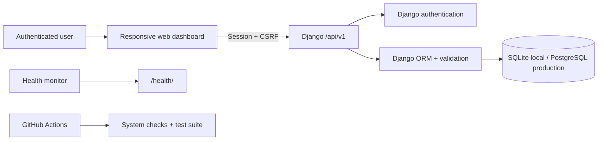

# HabitPulse

**A secure, full-stack habit management platform built for private, measurable personal progress.**

[](https://github.com/haarikaalla/Smart-Habit-Pulse-Tracker-Management-System/actions/workflows/ci.yml)


HabitPulse turns a simple habit checklist into an end-to-end web product. It combines an authenticated Django backend, a responsive JavaScript dashboard, versioned JSON APIs, per-user data isolation, production-safe configuration, automated tests, Docker packaging, and continuous integration.

The project demonstrates the engineering concerns behind a real multi-user product: identity, authorization, input validation, transactional updates, secret management, persistence, deployment, observability, and regression protection.

## Why this project matters

Habit trackers handle personal behavioral data. A useful product must do more than add and delete rows: it must ensure one user cannot read or modify another user's habits, report progress clearly, reject invalid input, and behave consistently across development and deployment environments.

HabitPulse addresses those requirements with:

- authenticated, user-owned habit records;
- a focused dashboard with live progress statistics;
- CSRF-protected browser mutations;
- server-side validation and clear HTTP error responses;
- environment-driven secrets and database configuration;
- SQLite for frictionless local development and PostgreSQL for deployment;
- a health endpoint for container and platform monitoring;
- automated coverage of authentication, ownership, validation, and API behavior.

## Product capabilities

| Capability | Implementation | Impact |
| --- | --- | --- |
| Secure accounts | Django session authentication | Every habit belongs to an authenticated user |
| Habit lifecycle | Create, list, edit, complete, and delete | Covers the full daily habit workflow |
| Weekly targets | Validated goals from 1–7 sessions | Makes habits measurable rather than binary notes |
| Progress summary | Total, completed, pending, and completion rate | Gives users an immediate view of momentum |
| Responsive dashboard | HTML, modern CSS, and asynchronous JavaScript | Fast interactions without full-page reloads |
| Versioned API | Routes grouped under `/api/v1/` | Provides a stable contract for future clients |
| Operational health | Public `/health/` endpoint | Supports uptime checks and container orchestration |
| Deployment path | Gunicorn, WhiteNoise, Docker, PostgreSQL | Moves cleanly from laptop to hosted environment |

## Architecture



The dashboard and API are served by one Django application. This keeps authentication and CSRF behavior consistent while still separating the presentation layer from the JSON contract. Querysets are always scoped to `request.user`, making ownership enforcement a backend invariant rather than a frontend convention.

## Technology stack

### Application

- **Python 3.12** — modern language runtime
- **Django 6** — authentication, routing, ORM, migrations, and security middleware
- **JavaScript + Fetch API** — asynchronous dashboard interactions
- **HTML5 and CSS3** — responsive, accessible interface

### Data and deployment

- **PostgreSQL 17** — production relational database
- **SQLite** — zero-configuration local development database
- **Gunicorn** — production WSGI application server
- **WhiteNoise** — static asset serving
- **Docker and Docker Compose** — repeatable application and database environment
- **GitHub Actions** — automated validation on pushes and pull requests

## API overview

All habit endpoints require an authenticated session. Browser-changing requests also require Django's CSRF token.

| Method | Endpoint | Purpose |
| --- | --- | --- |
| `GET` | `/health/` | Service and API-version health check |
| `GET` | `/` | Authenticated dashboard |
| `GET` | `/api/v1/habits/` | List the current user's habits |
| `POST` | `/api/v1/habits/` | Create a habit |
| `PATCH` | `/api/v1/habits/{id}/` | Rename or update completion state |
| `DELETE` | `/api/v1/habits/{id}/` | Delete an owned habit |
| `GET` | `/api/v1/summary/` | Return aggregate progress metrics |

Example create payload:

```json
{
  "name": "Read for 30 minutes",
  "target_per_week": 5
}
```

Example summary response:

```json
{
  "total": 4,
  "completed": 3,
  "pending": 1,
  "completion_rate": 75.0
}
```

## Run locally

### Prerequisites

- Python 3.12+
- Git

### Installation

```bash
git clone https://github.com/haarikaalla/Smart-Habit-Pulse-Tracker-Management-System.git
cd Smart-Habit-Pulse-Tracker-Management-System

python -m venv .venv
source .venv/bin/activate            # Windows: .venv\Scripts\activate
python -m pip install --upgrade pip
pip install -r requirements.txt

cp .env.example .env
python manage.py migrate
python manage.py createsuperuser
python manage.py runserver
```

Open `http://127.0.0.1:8000/` and sign in with the account you created.

## Run with Docker

Create a local `.env` file containing strong, non-default values:

```dotenv
SECRET_KEY=replace-with-a-long-random-secret
POSTGRES_PASSWORD=replace-with-a-strong-database-password
```

Then start the web service and PostgreSQL:

```bash
docker compose up --build
```

The web container applies migrations before starting Gunicorn. PostgreSQL data is retained in the named `habitpulse-data` volume.

## Configuration

| Variable | Default | Description |
| --- | --- | --- |
| `SECRET_KEY` | Required outside development | Django cryptographic signing key |
| `DEBUG` | `False` | Enables Django debug mode when explicitly set |
| `ALLOWED_HOSTS` | `127.0.0.1,localhost` | Comma-separated accepted hosts |
| `DATABASE_URL` | `sqlite:///db.sqlite3` | SQLite or PostgreSQL connection URL |
| `DATABASE_SSL` | `false` | Requires SSL for the database connection |
| `CSRF_COOKIE_SECURE` | `false` | Sends the CSRF cookie over HTTPS only |
| `SESSION_COOKIE_SECURE` | `false` | Sends the session cookie over HTTPS only |

Never commit a real `.env` file or production credentials.

## Security model

- Every read and write is scoped to the authenticated user.
- Django sessions and password hashing provide account security.
- CSRF middleware protects browser-based state changes.
- Request bodies are parsed defensively and validated server-side.
- Secret keys, hosts, database URLs, and secure-cookie flags come from the environment.
- ORM queries avoid manual SQL construction.
- Production checks run in CI to catch unsafe configuration regressions.

## Quality and testing

Run the complete local verification suite:

```bash
python manage.py check
python manage.py test
```

The tests cover protected routes, per-user record isolation, valid creation, invalid targets, update behavior, deletion, and summary calculations. GitHub Actions installs a clean environment and runs the checks for every push and pull request.

## Project structure

```text
.
├── .github/workflows/ci.yml       # automated checks
├── habitpulse/                    # Django project configuration
├── tracker/
│   ├── migrations/               # versioned schema changes
│   ├── static/tracker/            # dashboard CSS and JavaScript
│   ├── templates/                 # dashboard and authentication UI
│   ├── tests/                     # API and security regression tests
│   ├── models.py                  # user-owned habit model
│   ├── secure_views.py            # dashboard, API, validation, health
│   └── urls.py                    # application routes
├── .env.example                   # safe configuration template
├── compose.yaml                   # web + PostgreSQL stack
├── Dockerfile                     # production image
├── manage.py
└── requirements.txt
```

## Engineering decisions

- **One secure backend for UI and API:** avoids duplicating identity logic while preserving a clean API boundary.
- **Database portability:** SQLite makes onboarding easy; `DATABASE_URL` enables PostgreSQL without code changes.
- **Versioned endpoints:** clients can evolve without silently breaking existing integrations.
- **Backend-owned authorization:** frontend filtering is never trusted as a security boundary.
- **Small operational surface:** health checks, containers, migrations, and CI are included without adding unnecessary infrastructure.

## Roadmap

- recurring streak and historical completion events;
- reminders and notification preferences;
- richer analytics by week and category;
- password reset and email verification;
- accessibility and browser end-to-end tests;
- rate limiting, structured logging, and production telemetry;
- managed deployment with HTTPS, backups, and zero-downtime migrations.

