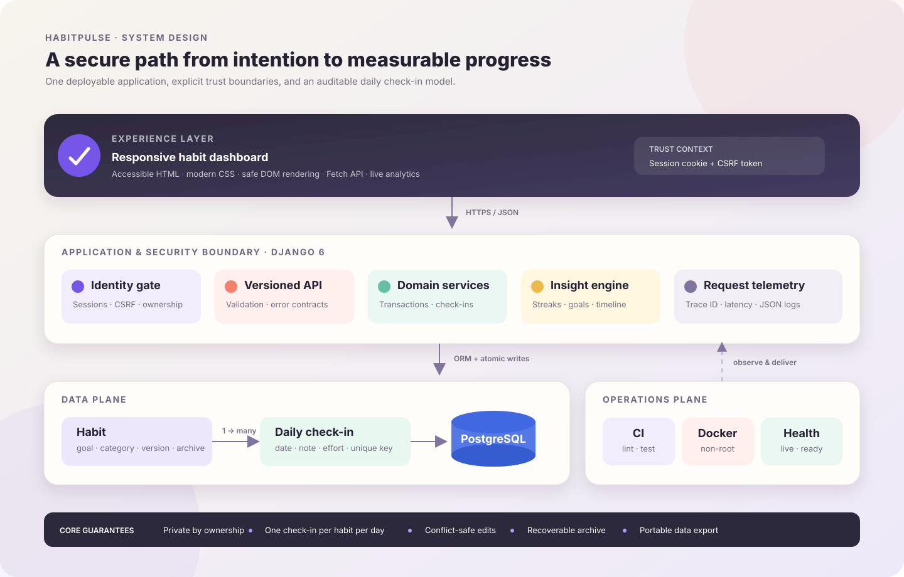
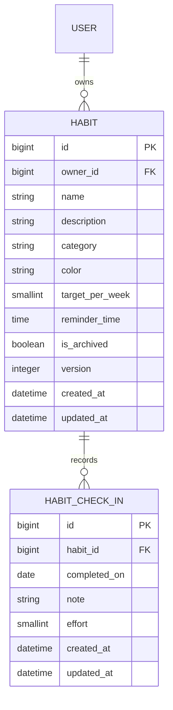

<div align="center">

# HabitPulse

### Turn daily intentions into measurable momentum.

An end-to-end habit intelligence platform with private check-ins, streak analytics, weekly goal tracking, conflict-safe updates, data export, and a production-ready Django deployment path.

[](https://github.com/haarikaalla/Smart-Habit-Pulse-Tracker-Management-System/actions/workflows/ci.yml)


</div>

---

## The product in one minute

Most habit demos store one Boolean value: done or not done. That loses the history needed to answer useful questions. HabitPulse treats behavior as a time series. Every completion is a dated, user-owned event, so the product can calculate daily completion, weekly target adherence, current and best streaks, category activity, and a 28-day consistency map without inventing data.

The result is both a usable product and a software-engineering case study. It demonstrates how a browser interface, versioned API, domain service layer, relational model, security controls, telemetry, tests, and container delivery fit together in one coherent system.

### What a user can do

- create a habit with a reason, category, weekly target, color, and optional reminder time;
- record or reverse one idempotent check-in per habit per calendar day;
- see today’s completion rate, weekly adherence, streaks, a seven-day trend, and a 28-day heatmap;
- search and filter habits without reloading the page;
- safely edit a habit even when more than one browser session is open;
- archive a habit without losing its historical check-ins;
- export all personal data as portable JSON.

> **Measured quality:** the current verification suite contains **16 passing tests** and reports **91% application-code coverage**. These figures come from `coverage run manage.py test && coverage report` and are enforced by CI with an 85% minimum threshold.

## Why it is more than a CRUD demo

| Engineering concern | HabitPulse implementation | Why it matters |
| --- | --- | --- |
| Historical truth | A separate `HabitCheckIn` event for each completed date | Streaks and trend analytics remain reproducible |
| Data ownership | Every API queryset is scoped to the authenticated user | A user cannot read or mutate another user’s records |
| Safe repeated requests | Unique `(habit, completed_on)` constraint plus `update_or_create` | Retrying a check-in does not create duplicates |
| Concurrent edits | Integer version with transactional row locking | Stale browser tabs receive `409 Conflict` instead of overwriting newer work |
| Recoverability | Archive state and timestamp instead of destructive deletion | Historical behavior remains available for export and audit |
| Contract stability | All product APIs live under `/api/v1/` | Future clients can evolve against a clear boundary |
| Operational readiness | Liveness, database readiness, request IDs, latency logs | Deployments can be monitored and individual requests traced |
| Release confidence | Lint, migrations, deploy checks, coverage, and image build in CI | Regressions are stopped before they reach `main` |

## Architecture



HabitPulse uses a modular monolith: one deployable Django service with explicit boundaries between presentation, API handling, domain behavior, persistence, and operations. This keeps the operational footprint small while preserving the separation needed to add a mobile client, background reminders, or a dedicated analytics service later.

### How a check-in travels through the system

1. The dashboard sends `PUT /api/v1/habits/{id}/check-in/` with the Django session and CSRF token.
2. Authentication establishes the user; the service queries the habit by both `id` **and** `owner`.
3. Domain validation rejects a malformed date, future date, invalid effort score, or oversized note.
4. An atomic upsert records at most one event for that habit and date. Sending `completed: false` reverses it.
5. The analytics selector rebuilds streaks, goal adherence, chart points, and heatmap intensity from persisted events.
6. The response receives an `X-Request-ID`; structured logs record the route, status, latency, and authenticated user ID.

### Data model



Database constraints enforce a target from 1–7 days, effort from 1–5, one active habit name per user (case-insensitive), and one check-in per habit per date. Indexes support the most common owner, archive-state, category, and date lookups.

## Interface

The responsive dashboard is intentionally framework-light: semantic templates, modern CSS, and dependency-free JavaScript. This keeps the client fast and makes the browser/API boundary easy to inspect.

The interface includes:

- four live product metrics;
- a seven-day completion chart and 28-day consistency heatmap;
- responsive habit cards with weekly progress, streak, and one-click check-in;
- accessible dialog-based create/edit flow, form errors, empty states, and status toasts;
- search and category filtering;
- reduced-motion support, keyboard focus states, semantic labels, and mobile layouts;
- safe DOM construction with `textContent` for user-generated values.

## API contract

Habit and analytics endpoints require an authenticated Django session. State-changing requests require a valid CSRF token. Errors use a consistent shape:

```json
{
  "error": {
    "code": "version_conflict",
    "message": "This habit changed in another session. Refresh before saving again."
  }
}
```

| Method | Endpoint | Purpose |
| --- | --- | --- |
| `GET` | `/health/live/` | Process liveness; does not require authentication |
| `GET` | `/health/ready/` | Readiness check including a database query |
| `GET` | `/` | Authenticated product dashboard |
| `GET` | `/api/v1/habits/` | List active habits; supports `q` and `category` filters |
| `POST` | `/api/v1/habits/` | Create and validate a user-owned habit |
| `GET` | `/api/v1/habits/{id}/` | Retrieve one owned habit |
| `PATCH` | `/api/v1/habits/{id}/` | Update with an `expected_version` precondition |
| `DELETE` | `/api/v1/habits/{id}/` | Soft-archive while retaining history |
| `PUT` | `/api/v1/habits/{id}/check-in/` | Idempotently create, update, or remove a daily check-in |
| `GET` | `/api/v1/analytics/?days=28` | Return summary, timeline, categories, and per-habit insights |
| `GET` | `/api/v1/export/` | Download all owned habits and check-ins as JSON |

### Create a habit

```http
POST /api/v1/habits/
Content-Type: application/json
X-CSRFToken: <token>
```

```json
{
  "name": "Read for 30 minutes",
  "description": "Replace late-night scrolling with focused reading",
  "category": "learning",
  "target_per_week": 5,
  "reminder_time": "21:00",
  "color": "#7657E8"
}
```

### Record or reverse a check-in

```json
{
  "date": "2026-10-20",
  "completed": true,
  "effort": 4,
  "note": "Finished one chapter"
}
```

Omit `date` to use the server’s local date. Send the same request again to update the note or effort without creating a duplicate. Send `completed: false` to remove that day’s check-in.

### Conflict-safe update

```json
{
  "name": "Read without distractions",
  "target_per_week": 6,
  "expected_version": 3
}
```

The write occurs inside a database transaction with a row lock. A stale version returns HTTP `409`, preserving the newer record.

## Technology choices

### Product and data

- **Python 3.12+ and Django 6** — routing, authentication, ORM, migrations, security middleware, admin, and server-rendered entry points;
- **PostgreSQL 17** — production relational consistency and constraints;
- **SQLite** — zero-configuration local development;
- **HTML5, CSS3, and JavaScript Fetch API** — responsive, accessible interface with no frontend build chain;
- **Gunicorn and WhiteNoise** — production WSGI serving and compressed, content-hashed static assets.

### Quality and operations

- **Django TestCase** — API, security, analytics, and persistence integration tests;
- **Coverage.py** — measured application coverage with an enforced floor;
- **Ruff** — Python correctness, import, Django, and modernization rules;
- **Docker / Compose** — non-root production image plus health-checked PostgreSQL;
- **GitHub Actions** — Python 3.12/3.13 matrix, schema drift check, production configuration check, tests, coverage, lint, and container build.

## Security model

Security is implemented as a set of backend invariants rather than frontend assumptions:

- session authentication protects the dashboard and every personal-data API;
- CSRF middleware protects all browser mutations;
- ownership is included in every habit lookup and mutation query;
- validation runs server-side and database constraints provide a second line of defense;
- ORM parameters avoid hand-built SQL;
- `SECRET_KEY`, hosts, database URL, trusted origins, HTTPS behavior, and logging level come from environment variables;
- session cookies are `HttpOnly` and `SameSite=Lax`; secure-cookie flags are enabled through production configuration;
- response hardening includes `nosniff`, same-origin referrer policy, and clickjacking denial;
- production can enable SSL redirect and HSTS without weakening local HTTP development;
- the container runs as an unprivileged operating-system user.

## Observability and reliability

Every response includes an `X-Request-ID`. The application emits one structured JSON event per completed request containing its method, path, status code, duration, request ID, and authenticated user ID when available.

Two health endpoints serve different operational purposes:

- **liveness** answers whether the application process can respond;
- **readiness** also checks the database and returns `503` when it is unavailable.

Docker and Compose use readiness for health checks. Compose does not start the application until PostgreSQL reports healthy, and migrations run before Gunicorn begins serving traffic.

## Test strategy

The 16-test suite covers behavior at the system boundary rather than only individual functions:

- login protection and CSRF enforcement;
- public liveness/readiness and request IDs;
- full habit creation contract and invalid JSON/field handling;
- case-insensitive duplicate prevention;
- search/category filters and cross-user isolation;
- optimistic concurrency conflicts;
- idempotent and reversible check-ins;
- future-date rejection;
- soft archive with history preservation;
- 28-day analytics and streak calculations;
- user-scoped portable export.

Run the same local quality gate used in CI:

```bash
ruff check .
python manage.py makemigrations --check --dry-run
coverage run manage.py test
coverage report
```

## Run locally

### Prerequisites

- Python 3.12 or newer
- Git

### Setup

```bash
git clone https://github.com/haarikaalla/Smart-Habit-Pulse-Tracker-Management-System.git
cd Smart-Habit-Pulse-Tracker-Management-System

python -m venv .venv
source .venv/bin/activate                 # Windows: .venv\Scripts\activate
python -m pip install --upgrade pip
pip install -r requirements-dev.txt

cp .env.example .env
python manage.py migrate
python manage.py createsuperuser
python manage.py runserver
```

Open `http://127.0.0.1:8000/` and sign in with the account you created. Local HTTP is supported; secure-cookie and HTTPS redirect settings remain disabled in `.env.example` for that reason.

## Run the production-shaped stack

Create `.env` with strong values:

```dotenv
SECRET_KEY=generate-a-long-unguessable-value
POSTGRES_PASSWORD=generate-a-separate-strong-password
```

Then run:

```bash
docker compose up --build
```

The stack exposes the application at `http://127.0.0.1:8000`. The image is built in two stages, contains only runtime dependencies, serves hashed static assets, and runs as the unprivileged `habitpulse` user.

## Configuration reference

| Variable | Local default | Production guidance |
| --- | --- | --- |
| `SECRET_KEY` | Required unless `DEBUG=True` | Inject from a secret manager; never commit it |
| `DEBUG` | `False` | Keep `False` |
| `ALLOWED_HOSTS` | `127.0.0.1,localhost` | Set the deployed hostnames |
| `DATABASE_URL` | `sqlite:///db.sqlite3` | Use a managed PostgreSQL URL |
| `DATABASE_SSL` | `false` | Enable when the database requires TLS |
| `CSRF_TRUSTED_ORIGINS` | empty | Add full HTTPS origins behind a proxy |
| `CSRF_COOKIE_SECURE` | `false` | Set `true` under HTTPS |
| `SESSION_COOKIE_SECURE` | `false` | Set `true` under HTTPS |
| `SECURE_SSL_REDIRECT` | `false` | Set `true` when TLS termination is configured |
| `SECURE_HSTS_SECONDS` | `0` | Increase deliberately after HTTPS is proven |
| `LOG_LEVEL` | `INFO` | Use the platform’s desired verbosity |

## Repository map

```text
.
├── .github/workflows/ci.yml        # multi-version quality and image gate
├── docs/habitpulse-architecture.svg # human-readable system architecture
├── habitpulse/
│   ├── logging.py                  # structured JSON formatter
│   ├── middleware.py               # request ID and latency telemetry
│   ├── settings.py                 # environment-driven security and storage
│   └── urls.py
├── tracker/
│   ├── migrations/                 # forward-only, versioned schema evolution
│   ├── static/tracker/             # responsive dashboard assets
│   ├── templates/                  # dashboard and login experience
│   ├── tests/                      # integration and domain regression suite
│   ├── admin.py                    # operational data administration
│   ├── models.py                   # habits, daily events, database guarantees
│   ├── secure_views.py             # authenticated HTTP/API boundary
│   └── services.py                 # transactions, validation, analytics
├── .env.example                    # safe configuration contract
├── compose.yaml                    # health-checked web + PostgreSQL stack
├── Dockerfile                      # multi-stage, non-root runtime image
├── pyproject.toml                  # lint and coverage policy
├── requirements.txt                # runtime dependencies
└── requirements-dev.txt            # repeatable development toolchain
```

## Deliberate design decisions

**Modular monolith over premature microservices.** Authentication, API, analytics, and UI share one transactional data model and deployment unit. The internal boundaries are explicit enough to extract later if scale requires it.

**Event history over a completion flag.** A Boolean can describe now; an event stream explains change over time. Dated check-ins make every reported metric reproducible.

**Database guarantees plus application validation.** Friendly API errors help clients, while constraints keep the underlying data valid even if a new code path is introduced.

**Soft archive over hard delete.** Users can stop tracking a habit without destroying the evidence behind past analytics or exports.

**Optimistic version plus row lock.** The version detects stale intent; the transaction closes the race between validation and save.

**Progressive delivery posture.** Local development stays simple, while environment switches activate production cookies, HTTPS redirect, HSTS, PostgreSQL, and deployment checks.

## Honest boundaries and next evolution

The current release stores reminder preferences but does not send notifications. It also uses server-side sessions rather than token authentication and calculates personal analytics synchronously, which is appropriate for the current workload.

Logical next steps are background reminder delivery, password reset and email verification, pagination for very large histories, browser-level accessibility tests, API throttling, managed backups, and OpenTelemetry export. These are documented extensions—not features claimed by the current code.

---

<div align="center">
  <strong>HabitPulse shows the complete path from a product idea to a secure, tested, observable, and deployable system.</strong>
</div>
